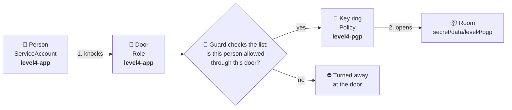
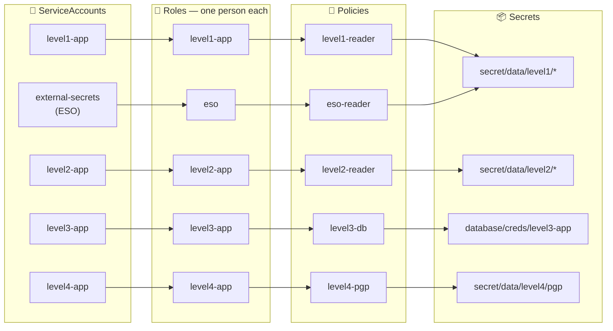
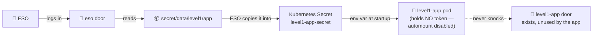
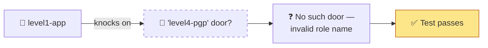
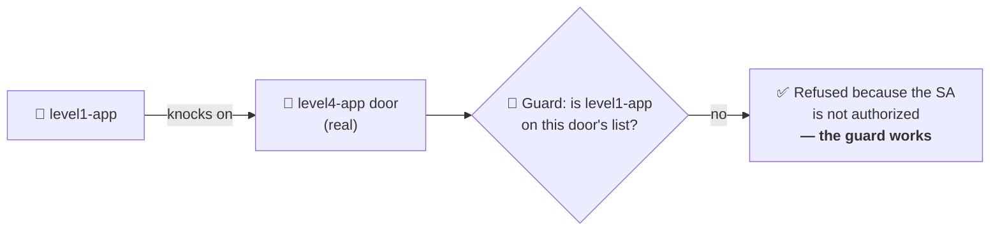
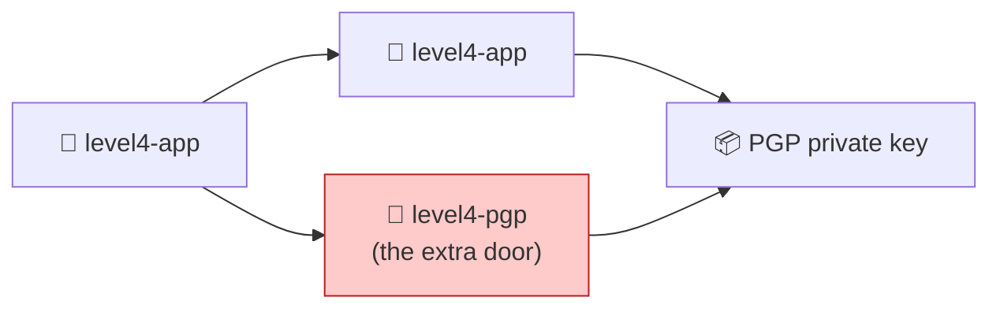

# Vault roles and policies — the door analogy

A plain-language guide to how Stage B's applications get permission to read
secrets, why one test in the PRDs was quietly broken, and the two decisions made
as a result.

---

## Two kinds of names that are easy to confuse

Vault has two different kinds of named things in this design, and they do
completely different jobs.

| Analogy | Vault term | What it is | Examples in this repo |
|---|---|---|---|
| 🚪 **A door** | **Role** | Where you log in. The door has a **guard** with a list of who may come through | `level1-app`, `level2-app`, `level3-app`, `level4-app`, `eso` |
| 🔑 **A key ring** | **Policy** | What you can open once you are inside | `level1-reader`, `level2-reader`, `level3-db`, `level4-pgp`, `eso-reader` |
| 🧑 **A person** | **ServiceAccount** | Who is knocking. In Kubernetes, a pod's identity *is* its ServiceAccount | `level1-app`, `level2-app`, `level3-app`, `level4-app` |
| 📦 **A room** | **Secret path** | Where the secret actually lives | `secret/data/level4/pgp`, `database/creds/level3-app` |

The confusing part is the naming. The **person** `level1-app` walks through the
**door** `level1-app`. The people and the doors share names on purpose, but they
are different objects. And `level4-pgp` is a **key ring**, not a door, even
though it looks like it could be one.

---

## How a pod gets a secret

There are **two separate checks**, and they fail differently:

1. **At the door** (login). The guard checks whether this person is on the door's
   list. If not, they never get inside.
2. **At the room** (read). Once inside, the key ring decides which rooms open. A
   person can be through the door and still be refused a room.

---

## The whole building

Every person has exactly **one** door, and every door admits exactly **one**
person. That one-to-one rule is the entire isolation boundary, because all four
levels live in the same Kubernetes namespace. Nothing else separates them.

Two rooms are reachable by more than one route, and both are deliberate:

- **`level1/*`** is opened by both `level1-reader` and `eso-reader`. ESO is how
  Level 1's app actually receives its secret (see the next section).
- The `default` ServiceAccount appears on **no** door. A pod that forgets to set
  `serviceAccountName` becomes `default` and is turned away everywhere — which is
  the safe failure.

---

## Decision 1 — `level1-app` keeps its door, but never uses it

**The conflict.** The two PRDs disagree:

- **Stage B, Phase B1** says the `level1-app` ServiceAccount is *"never granted a
  Vault role — demonstrating that it needs none."*
- **Stage A, Phase A6.6** creates a `level1-app` role bound to it.
- **Stage B, Phase B5** expects `level1-app` to be **allowed** to read
  `level1/app` in the privilege matrix.

**Decision (owner): keep the door**, following Stage A A6.6. The B5 matrix row
then stays exactly as the PRD wrote it.

**What this means in practice.** The door exists, but Level 1's app never walks
through it. ESO does the walking, through its own door, and hands the secret to
Level 1 as an environment variable.

**The trade-off, stated plainly:**

| | |
|---|---|
| ✅ Benefit | The B5 matrix runs exactly as written, and the setup matches Stage A A6.6 |
| ⚠️ Cost | It is an **unused credential**. Anyone allowed to mint a `level1-app` token in the namespace can log in through it, even though the app never does |
| 🛡️ Mitigation | Level 1's Deployment sets `automountServiceAccountToken: false`, so the running pod holds no token. A compromised Level 1 pod cannot use the door |

**Production alternative:** remove the role. An identity that no workload uses
should hold no credential.

---

## Decision 2 — no door named `level4-pgp`; fix the test instead

### The broken test

Two places in the PRDs (Stage A A6.8, Stage B B5) describe the same check:

> *"`level1-app` SA requesting role `level4-pgp` → denied"*

The goal is to prove that **the guard at Level 4's door turns Level 1 away.** But
`level4-pgp` is a key ring, not a door. **There is no door with that name.**

The test goes green — but for the wrong reason. Level 1 was refused because the
door does not exist, not because a guard checked a list. **The guard was never
tested.**

It is like testing a nightclub's bouncer by trying to get into a club that does
not exist. You are refused, and you have learned nothing about the bouncer.

### The fixed test

Send Level 1 to the **real** door, `level4-app`, and check *why* it was refused.

The *reason* for the refusal is what makes the test real:

| Vault's answer | Meaning | Test result |
|---|---|---|
| `service account name not authorized` | The guard checked the list and said no | ✅ **Pass** |
| `invalid role name "…"` | There is no such door | ❌ **Broken test**, even though it looks like a pass |

The B5 scripts assert on this text rather than on the HTTP status alone. Both
answers are refusals, and which status code each one carries is an
implementation detail of the Vault version — not something a test should lean
on. The exact wording should be confirmed against the deployed Vault version
(2.0.4); the scripts record the raw message so it can be checked, and treat any
refusal whose reason they don't recognise as a failure rather than a pass.

### Why not just build a `level4-pgp` door?

Building one would make the test's sentence true, but it would add a **second
door into the most sensitive room in the building.**

Whichever person the new door admits, it is bad:

- **If it admits Level 4:** it is a pointless duplicate. There are now two doors
  into the PGP room to watch, and a mistake on either exposes the key.
- **If it admits anyone else:** it lets the wrong person into the PGP room. That
  is worse than a duplicate.

It would also **fail Phase B5's own check**, which requires each ServiceAccount
to map to *exactly one* role. Whichever person the new door admitted would then
have two.

**Decision (owner): no `level4-pgp` role.** One door per level, and the test
aims at the real door.

### A knock-on effect on two other tests

Because every door admits exactly one person, no pod can ever log in through
another level's door. Two failure injections assumed it could:

- **Stage B B2, injection 1:** *"`VAULT_ROLE=level4-pgp` → login succeeds, read 403"*
- **Stage B B4, injection 6:** *"point at a role lacking `level4-pgp` → clean 403"*

Both describe getting *through* a door and then being refused a *room*. Under the
one-to-one rule, that cannot happen — the guard stops you first. What they were
trying to prove is already covered: the B5 matrix has each person use **their
own** door and then try every room, which produces exactly those room-level
refusals. Both injections are marked **superseded by the B5 matrix** in the
Level 2 and Level 4 READMEs.

---

## What Phase B5 actually checks

### Room check — the 4×4 matrix

Each person logs in through **their own** door, then tries every room.

| Person (own door) ↓ / Room → | `level1/app` | `level2/app` | `database/creds` | `level4/pgp` |
|---|---|---|---|---|
| `level1-app` | ✅ allow | ⛔ deny | ⛔ deny | ⛔ deny |
| `level2-app` | ⛔ deny | ✅ allow | ⛔ deny | ⛔ deny |
| `level3-app` | ⛔ deny | ⛔ deny | ✅ allow | ⛔ deny |
| `level4-app` | ⛔ deny | ⛔ deny | ⛔ deny | ✅ allow |

**Four allows, twelve denials.**

### Door check — who may log in where

Each person tries every **other** person's door. Every attempt must be refused
**by the guard** (`service account name not authorized`), never by "no such
door". The `default` ServiceAccount must be refused at every door.

| Person ↓ / Door → | `level1-app` | `level2-app` | `level3-app` | `level4-app` |
|---|---|---|---|---|
| `level1-app` | ✅ own door | 👮 refused | 👮 refused | 👮 refused |
| `level2-app` | 👮 refused | ✅ own door | 👮 refused | 👮 refused |
| `level3-app` | 👮 refused | 👮 refused | ✅ own door | 👮 refused |
| `level4-app` | 👮 refused | 👮 refused | 👮 refused | ✅ own door |
| `default` | 👮 refused | 👮 refused | 👮 refused | 👮 refused |

The PRD only asks for one cell of this grid (`level1-app` → Level 4's door). The
full grid costs nothing extra to run, so the scripts run all of it.

---

## Quick reference

| If you see… | It means… |
|---|---|
| A name ending in `-app` | A ServiceAccount **and** its matching role. Same name, different objects |
| A name like `-reader`, `-db`, `-pgp` | A **policy** — a key ring. Never a door |
| `invalid role name` | Someone knocked on a door that does not exist. In a test, this means the test is broken |
| `service account name not authorized` | A guard checked the list and refused. In a denial test, this is the pass |
| HTTP 403 on a **read** | Through the door, but the key ring does not open that room |

**Sources:** Stage A PRD §6 A6.5–A6.8 (policies, roles, negative tests); Stage B
PRD §5 B1, B2, B4, B5 (the level descriptions and the matrix). Both decisions are
also recorded in `documents/troubleshooting.md`.
